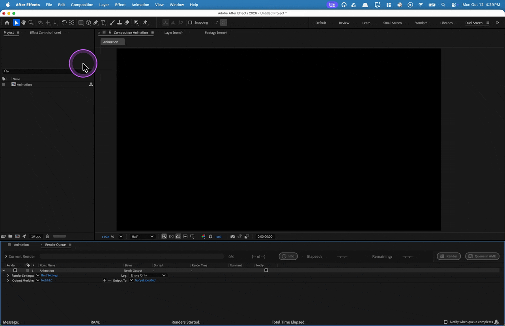
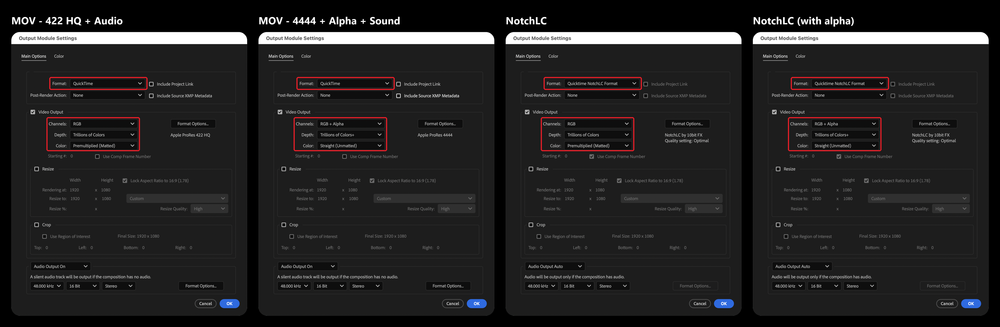
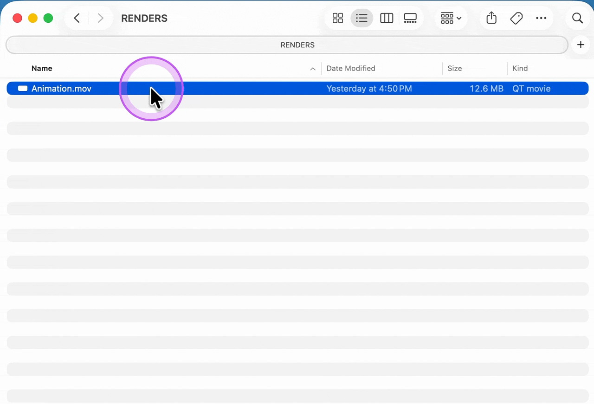
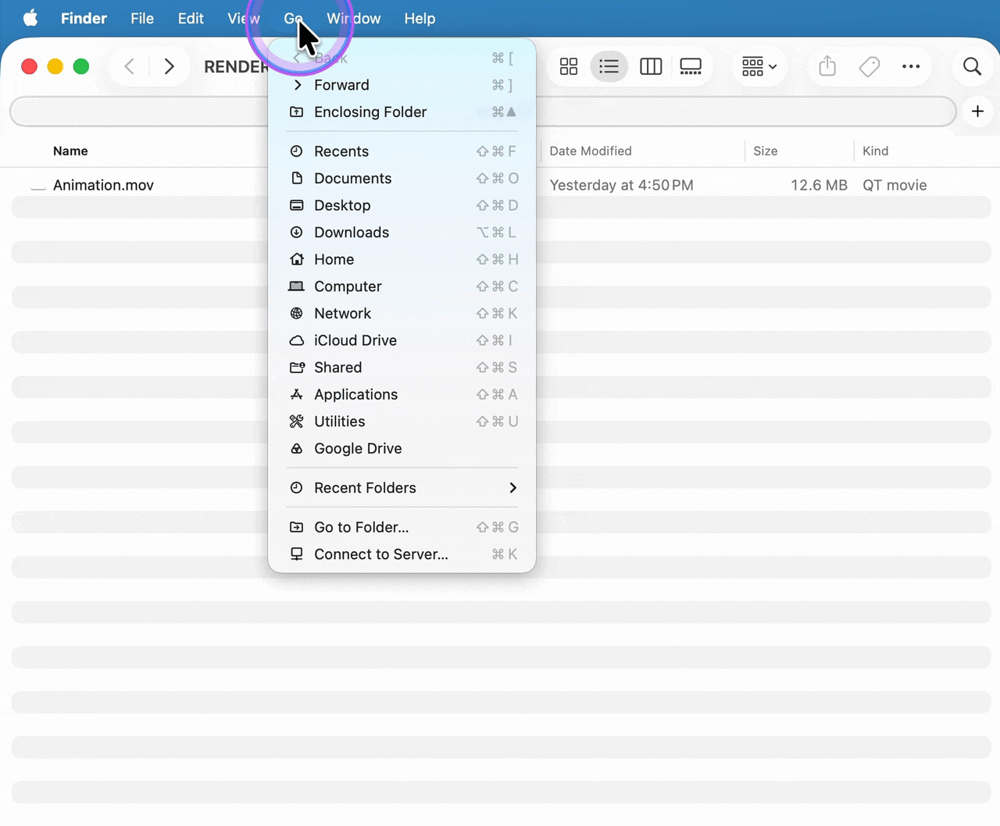
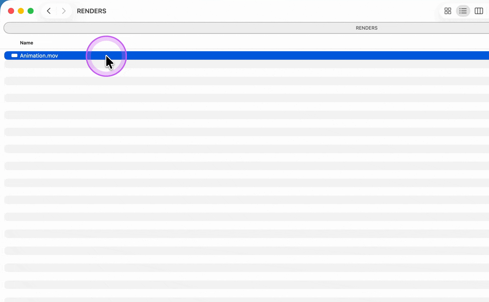

# keynote-motion-design-toolkit

After Effects render presets, a codec guide and macOS Quick Actions for motion designers working on keynote and live event projects, so everyone on the team renders the same way. Covers ProRes, NotchLC, HEVC and Disguise. The GIFs and screenshots made for the onboarding deck are in `docs/`.

## Contents

| Folder | What it is |
|---|---|
| `01_Plugins` | Link to download the free NotchLC plugin for Adobe (macOS and Windows) |
| `02_AfterEffects/01_AEP` | Where your team's After Effects project template (`.aep`) goes |
| `02_AfterEffects/02_RenderPresets` | Output module presets (`.aom`) for ProRes and NotchLC |
| `02_AfterEffects/03_RenderArray` | Render Array, a dockable script (`.jsx`) that queues a comp as several render items: split by markers, head and tail, or one PNG per marker |
| `02_AfterEffects/04_TimeArray` | Time Array, a preset (`.ffx`) that remaps a layer's Time Remap so it triggers from markers in the comp |
| `02_AfterEffects/05_TypeArray` | Link to download Paul Slemmer's Type Array text animation preset |
| `03_macOS/QuickActions` | macOS Quick Actions: Convert to HEVC 4k, with and without alpha |
| `docs` | `gifs/` and `images/` used in this README and the onboarding deck |

## Terminology

| Term | Plain meaning |
|---|---|
| Keynote | A type of presentation: a keynote or stage show, not the Apple app. Rendered content for it can be played back from different systems, such as Apple Keynote, Disguise, or other playback systems. |
| Apple Keynote | Apple's presentation software. Rendered video and graphics are placed into slides and played back from the presenter's Mac. |
| Disguise | Formerly d3. A media server platform used in live events and broadcast. It plays back video on LED walls, projection and stage screens, and handles large frame sizes in real time. Content is usually delivered to it as NotchLC. |
| Codec | The method used to compress a video. |
| NotchLC | A codec made for real-time playback. It is decoded by the computer's graphics card (GPU), so media servers like Disguise can play very large frames smoothly. Needs the free [NotchLC plugin](https://notchlc.notch.one/) to render from After Effects. |
| HEVC (H.265) | High Efficiency Video Coding, also called H.265. A modern codec that makes much smaller files than older ones like H.264 at similar visual quality. Plays on most current devices. We use it to cut file size by about 90%, so files are quick to upload, share and open, and use far less storage. |
| Master | The best-quality file you render first. All other versions come from it. |
| Alpha | The transparency channel. Needed for graphics with a see-through background. |

## Codec guide

### Quick answer: what do I render?

| I need... | Render as | Then |
|---|---|---|
| A master or editing file, no transparency | ProRes 422 HQ | - |
| A master or editing file, with transparency | ProRes 4444 | - |
| A file for Disguise or another media server | NotchLC | - |
| A small file for Apple Keynote | ProRes 422 HQ | Encode in HEVC |
| The same, with a transparent background | ProRes 4444 | Encode in HEVC with Preserve Transparency |

### Settings and limits by format

| | ProRes 422 HQ | ProRes 4444 | NotchLC | HEVC 4K (2160p) |
|---|---|---|---|---|
| **AE Output Module** | `MOV - 422 HQ + Audio` | `MOV - 4444 + Alpha + Sound` | `NotchLC` or `NotchLC (with alpha)` | Not rendered in AE |
| **Channels / Color** | RGB, Premultiplied | RGB + Alpha, Straight | RGB, Premultiplied / with alpha: RGB + Alpha, Straight | n/a |
| **Alpha (transparency)** | No | Yes | Yes, with its own template | Yes, with **Preserve Transparency** in Finder or the "with Alpha" Quick Action |
| **Alpha shows in After Effects** | n/a | Yes | Yes (tested) | No (tested) |
| **Editable / re-encodable** | Yes | Yes | Not intended for editing | No. Never convert it again |

> **Note:** Adobe Media Encoder, Premiere Pro and After Effects cannot directly export or interpret transparent HEVC files. The alpha channel is lost on import. Render the transparent master as ProRes 4444, then convert it to HEVC with the Mac Quick Action or Finder, for delivery only.

> **Tip:** to play back NotchLC files on a Mac, use the free [IINA](https://iina.io/) player.

## How-to guides

### Set up the toolkit for your team

If you are working with a team, set up one shared copy so everyone has the presets, project template and Quick Actions they need in one place:

1. Download this repo to your shared folder or drive so your teammates can use it.
2. Download the [NotchLC plugin](https://notchlc.notch.one/) (see `01_Plugins`), upload to the folder for your team, and install it as well.
3. Use the After Effects project template (`.aep`) provided, or replace it with your team's own template.
4. Make any necessary changes to fit your workflow.
5. Share this repo or the GIFs in `docs/gifs` with your team, so everyone knows how to install and use the tools.

### Import the .aom presets in After Effects

In After Effects, you can export your **Output Module Templates** (not to be confused with Render Settings Templates) into a .aom file and share it with other users. Below are steps on how to load the .aom into your After Effects.

1. In After Effects, go to Edit > Templates > Output Module.
2. Click **Load...** and choose one `.aom` file from `02_AfterEffects/02_RenderPresets`. Repeat for the other file.
3. The new templates now appear in the Output Module list.

If After Effects says some templates were not loaded because they have the same name, that's fine. Each `.aom` also contains After Effects' built-in templates, which you already have.

After loading, each template should match these Output Module Settings. The red boxes mark the fields to check: **Format**, then **Channels**, **Depth** and **Color**.

### Install Render Array in After Effects

1. Copy `Render Array v1.0.jsx` from `02_AfterEffects/03_RenderArray` into After Effects' `Scripts/ScriptUI Panels` folder.
2. Restart After Effects, then open **Render Array** from the **Window** menu and dock it.
3. Pick a mode, check the Segments preview, and click **Queue**. Items are only added to the Render Queue. Nothing renders until you start it.

To try it without installing, use **File > Scripts > Run Script File...** and it opens as a floating panel. Markers whose comment starts with `!` are listed as alerts and skipped.

### Apply the Time Array and Type Array presets

1. Select the layer: any layer for Time Array, a text layer for Type Array.
2. Choose **Animation > Apply Animation Preset...** and pick the `.ffx` file.

Type Array is not stored here. Download it from the link in `02_AfterEffects/05_TypeArray` first.

### Encode HEVC manually on a Mac

1. In Finder, right-click the master file and choose **Encode Selected Video Files**.
2. In the Encode Media window, set **Setting** to **HEVC 2160p**, and tick **Preserve Transparency** if the background must stay transparent.
3. Click **Continue**. The encoded file appears next to the master.

**HEVC 2160p** is the same as the 4K setting the Quick Actions use (up to 3840x2160).

The Setting menu also lists H.264 (480p to 2160p), HEVC (1080p, 2160p, 4320p), MV-HEVC, Apple ProRes and Audio Only.

### Install the Quick Actions on a Mac

> **Note:** For team members to align on encoding settings without having to memorize them or risk using the wrong ones, these Quick Actions apply the agreed HEVC settings with a single right-click.

1. In Finder, choose **Go > Go to Folder...** and open `~/Library/Services`.
2. Copy the two `.workflow` files from `03_macOS/QuickActions` into that folder.
3. Right-click any file and choose **Quick Actions > Customize...** (or open System Settings > **General > Login Items & Extensions > Finder**). Switch on **Convert to HEVC 4k** and **Convert to HEVC 4k with Alpha**, then click **Done**.

### Use the Quick Actions on a Mac

1. In Finder, right-click the master file and choose **Quick Actions**.
2. Choose **Convert to HEVC 4k**, or **Convert to HEVC 4k with Alpha** if the background must stay transparent.
3. The converted file appears next to the master, named `<name>_HEVC.mov`.

## Author

Made by Desmond Du. More work at [duitbetter.com](https://duitbetter.com).

## License

[MIT](LICENSE). Third-party software linked from this repo, such as the NotchLC plugin and Type Array, is not covered by this license and remains under its own terms.
